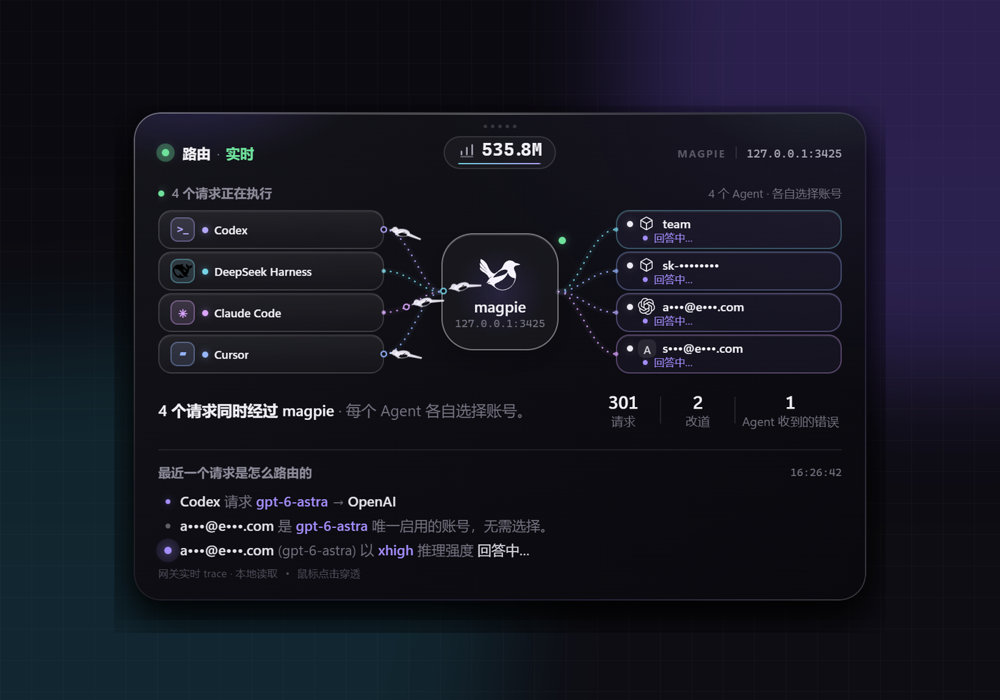
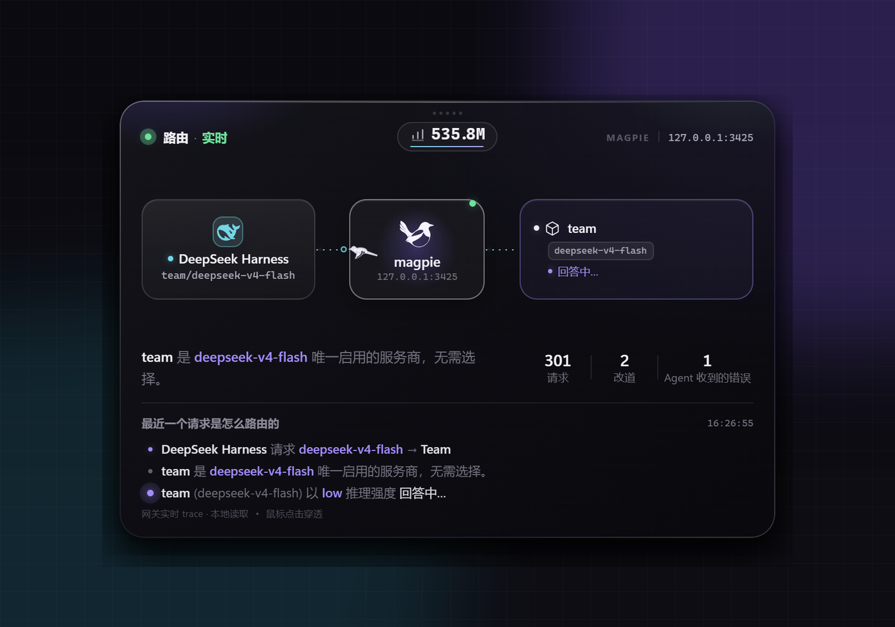
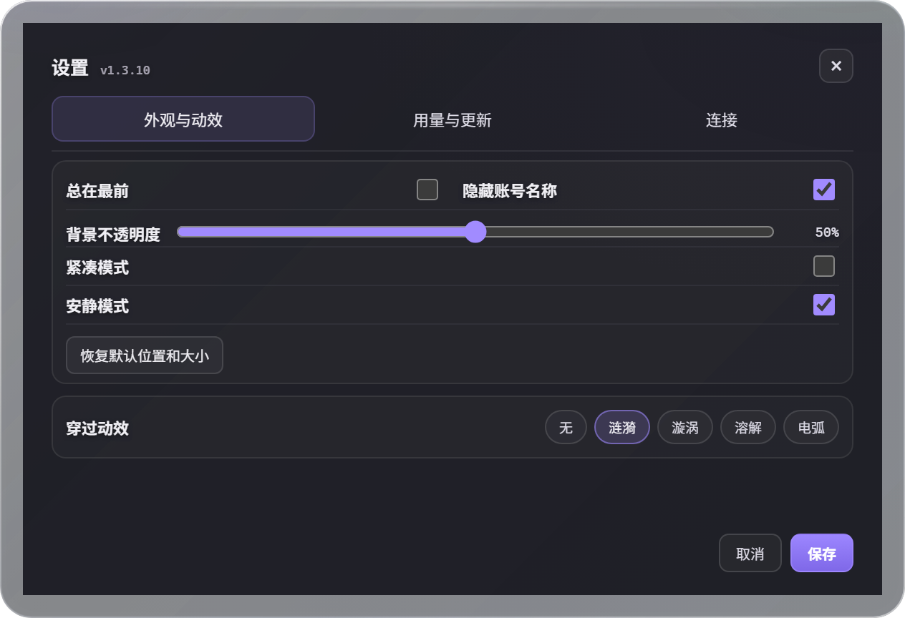

# Busy Magpie

**magpie 实时路由桌面挂件**

**A transparent, click-through live routing perch for your desktop.**

一张透明、无边框、鼠标可以穿透的实时卡片。它读取 magpie 本机 trace，显示当前 Agent 经过了哪些路由、最终落到哪个账号，以及这段时间用了多少 token。

A transparent, borderless, click-through card that reads magpie's local trace and shows which routes each agent took, which account it landed on, and the total tokens used.

[](#)
[](https://www.electronjs.org/)
[](./LICENSE)



> 截图为 v1.3.10 界面，使用本地模拟数据，账号已打码；离屏截图不反映桌面背景的原生模糊效果。

## 为什么是它

magpie 的「路由」页很好看，但它只在 magpie 自己的窗口里。Busy Magpie 把同一段实时链路变成一个常驻桌面的小层：

- **透明、无边框**，不挡桌面。背景不透明度可调，新用户默认 30%；文字和控件保持清晰。
- **点击穿透**：正常状态下鼠标点击会落到下面的窗口，不抢焦点。
- **不修改 magpie**：只读取本机的 `/v1/magpie/trace` 和 `/v1/magpie/usage`。
- **同时显示所有正在执行的 Agent**：Agent 在左，magpie 在中间，账号在右；线路在 magpie 处交叉。
- **会话模式**：左侧按 Agent 与会话分组；缺少会话 ID 时每个请求单独显示。闪电点亮表示最近普通请求申请 Fast，旁边显示 low / high / xhigh / max / ultra 等思考强度文字；缺少信息时隐藏对应标记。申请值缺失时使用当前尝试的发送值；标记不代表服务端已兑现 Fast，也不比较不同模型的思考能力。
- **线路是活的**：进行中的请求用流动的短虚线表示，沿 Agent → magpie → 账号方向移动；请求标记穿过 magpie 时触发一次涟漪 / 漩涡 / 溶解 / 电弧，也可以关掉。
- **请求标记使用对应 Agent 的品牌色**：标记、端口和连线取该 Agent 的颜色，四路并发时一眼能看出请求属于哪个 Agent。
- **不随 Agent 数量变高变矮**：窗口尺寸稳定，只有上半部视图收紧；需要更大或更小时手动拖边框。
- **总 token + 逐位滚动 + 单击换窗口**：读取 magpie usage，单击在 今日 / 7 天 / 30 天 / 全部 之间循环。
- **设置直接在当前面板展开**，保存后收回，不额外弹窗。

## 作为 magpie 插件

这个仓库同时是一个 **magpie 启动器插件**。安装它不会替换桌面卡片，而是在 magpie 第一次加载插件时，把已经安装的 Busy Magpie 桌面卡片启动起来：

```bash
magpie plugin add github:yimi1mi/busy-magpie
```

工作方式：

- 插件入口是 `plugin/launch.hooks.mjs`，在 `package.json` 的 `magpie.hooks` 里声明。
- magpie 第一次用到插件宿主时（通常是第一个 Agent 请求），查找已安装的 `Busy Magpie.exe` 并启动。
- 没安装时会自动从 GitHub 最新 release 下载安装包，校验 SHA-256 后静默安装到 `%LOCALAPPDATA%\Programs\Busy Magpie`，再启动。设置 `BUSY_MAGPIE_NO_INSTALL=1` 可以关闭自动安装。
- 下载开始、开始安装、安装完成/失败时都会发一条系统通知（Windows 用通知气泡，macOS 用通知中心）。如果系统开了专注模式，通知可能被折叠；插件日志里仍有 `[busy-magpie]` 记录。
- `plugin/server.mjs` 是一个空 provider stub，避免 magpie 把 Electron 主进程当成供应商插件加载。
- 如果安装在非默认目录，设置 `BUSY_MAGPIE_APP` 指向 `Busy Magpie.exe` 后重启 magpie：

```powershell
setx BUSY_MAGPIE_APP "D:\Apps\Busy Magpie\Busy Magpie.exe"
```

插件只负责启动桌面层；透明穿透、实时 trace 和所有界面仍然由 Electron 应用提供。magpie 的插件页面运行在沙盒 iframe 里，既拿不到实时 trace，也不能创建跨应用的透明窗口，所以这里采用启动器，而不是页面插件。

安装内置版本为 `v1.4.0`。桌面卡片、设置和托盘显示当前业务版本；业务包更新后，它可以高于运行环境版本。插件列表的版本仍由插件自身的 `package.json` 决定。

## 截图

### 一个请求



单个请求时保留大号路由舞台，下方是「最近一个请求是怎么路由的」和请求 / 改道 / 错误统计。

### 多个 Agent


两个及以上请求同时展开：每个 Agent / 会话组一条链路，在 magpie 处汇合，再分发到各自账号。同一 Agent 的不同会话分开显示，同一会话的并行请求合并成一组。账号列保持自己的顺序，线路会自然交叉。

### 设置



设置在卡片上展开，分为「外观与动效」「用量与更新」「连接」三页，无需滚动。设置项只保留名称和控件，保存和取消固定在底部。切页保留未保存的修改；关闭或保存后淡出回到卡片。

### 关于与更新


点右上角版本号打开。应用更新和启动器插件更新分开处理：应用可以直接更新，插件去 magpie 插件中心更新。

## 快速开始

### 直接运行源码

需要 Node.js 20+，以及本机正在运行的 magpie（默认 `127.0.0.1:3425`）。

```bash
npm install
npm start
```

`npm install` 只会把 Electron 装进当前项目的 `node_modules`，不会全局安装，也不会改系统 PATH。启动后没有任务栏窗口，只有桌面卡片和托盘图标。

### 构建安装包

```bash
# Windows：NSIS 安装包（x64）
npm run dist:win

# 输出到独立目录，保留原来的安装包和解包目录
npm run dist:win -- -OutputDirectory dist/local-1.4.0

# macOS：dmg + zip（x64 / arm64）
# 必须在 macOS 上执行
npm run dist:mac
```

产物在 `dist/`。也可以 `npm run pack` 生成未打包目录。

macOS 构建默认**不提供 Developer ID 签名和公证**；首次打开如果被 Gatekeeper 拦住，右键 → 打开，或：

```bash
xattr -dr com.apple.quarantine "/Applications/Busy Magpie.app"
```

CI 配置包含 `windows-latest` 上的 Windows 安装包构建、`macos-latest` 上的 dmg / zip 构建，以及 macOS 打包应用的业务更新、回退和重启保持测试。macOS 构建也会生成 `latest-mac.yml`。Windows 和 macOS 均支持签名业务包更新；运行环境的完整自动安装仅在 Windows 上可用，macOS 仍需手动安装。

## 安装路径

Windows 安装包是 **per-user** 安装（`nsis.perMachine: false`），默认目录是：

```text
%LOCALAPPDATA%\Programs\Busy Magpie\Busy Magpie.exe
```

这是 Windows 桌面软件的常见做法：程序放 `LOCALAPPDATA\Programs`，不需要管理员权限，也不会把可执行文件放进漫游配置。安装时仍可以改到其他目录。

用户配置和日志放在 **Roaming AppData**，因为它属于用户数据，不是程序本体：

```text
%APPDATA%\Busy Magpie\settings.json
%APPDATA%\Busy Magpie\busy-magpie.log
```

**不建议**把 `.exe` 装进 `%APPDATA%`（Roaming）：域账号或开启漫游配置时，几十 MB 的 Electron 程序会被同步到每台机器，启动和登录都会变慢。也不建议默认装进 `%ProgramFiles%`，那需要 UAC 提权，升级也更麻烦。

启动器插件的查找顺序：

1. `BUSY_MAGPIE_APP`
2. `%LOCALAPPDATA%\Programs\Busy Magpie`
3. `%LOCALAPPDATA%\Programs\busy-magpie` / `BusyMagpie`
4. `%LOCALAPPDATA%\Busy Magpie`
5. `%PROGRAMFILES%\Busy Magpie` / `%PROGRAMFILES(X86)%`
6. macOS `/Applications/Busy Magpie.app`

如果安装到了自定义目录，设置 `BUSY_MAGPIE_APP` 即可；默认路径下不需要配置。

### 卸载插件时会发生什么

magpie 插件没有卸载生命周期钩子，所以**移除插件不会自动删除 Busy Magpie 桌面应用**。插件只是启动器；应用是单独安装的程序，卸载插件后它会继续留在：

```text
%LOCALAPPDATA%\Programs\Busy Magpie
```

要移除应用，使用 Windows「设置 → 应用」里的 Busy Magpie 卸载，或运行：

```text
%LOCALAPPDATA%\Programs\Busy Magpie\Uninstall Busy Magpie.exe
```

如果希望插件和桌面应用一起删，需要把应用改成插件目录内的便携版；当前版本没有这样做。

## 交互

### 操作菜单

右上角的 `···` 常驻显示，点击可打开设置、隐藏挂件或查看关于与更新。菜单展开后暂时接收鼠标操作；按 Esc、点击卡片空白处或切到其他窗口会收起菜单，恢复点击穿透。方向键可选择菜单项，Enter 执行。

首次启动直接显示卡片，不再弹出使用指南。

### 紧凑模式

菜单里的「紧凑模式」把窗口收为 `360×112` 的状态条，显示连接状态、活动请求数和当前用量。`↗` 恢复完整路由视图；点击 `···` 或打开设置时临时展开，关闭后回到原来的紧凑位置。完整视图的尺寸独立保留，紧凑状态不接受边框缩放。

### 移动

- **长按卡片顶部**（中间一排小圆点）约 0.15 秒即可拖动；松手恢复点击穿透。

### 调整大小

- 鼠标移到卡片**任意一条边框或四个角**，出现对应方向的缩放光标后直接拖动。
- 上边/左边拖动时会同时移动窗口，保持对面的边不动。
- 最小约 `632×432`（再小会按比例拉回），最大不超过当前屏幕可用区域。
- 尺寸会写入 `settings.json`，下次启动保持。
- 设置或托盘菜单里的「恢复默认位置和大小」可把挂件找回主屏。断开显示器或改变分辨率时，窗口会重新限制到现有屏幕的可用区域。

### 点击穿透

正常状态以下区域会在鼠标悬停时临时接收指针：

- 顶部约 28px 的移动条
- 四条边的 7px 缩放带和四角的 14×14px 缩放区域
- 顶部中间的 token 胶囊
- 右上角的操作菜单、版本号或更新按钮

其余区域始终穿透，点击会落到下面的窗口。操作菜单、设置、关于、调整位置模式下整张卡片会接收指针，关闭后恢复穿透；点击卡片空白处收起菜单时，该次点击不会再触发卡片上的其他操作。

## 路由视图

### 单请求

```text
DeepSeek Harness  ┈┈┈┈  magpie  ┈┈┈┈  team
会话或目录信息                         deepseek-v4-flash
high                                   回答了这个请求
```

下方显示「最近一个请求是怎么路由的」三行说明，以及请求数、改道数、Agent 收到的错误数。

### 多请求

```text
DeepSeek Harness ┈┐
                  ├─→  magpie  ─→  team
Codex            ┈┘              OpenAI
```

- 请求卡片按 Agent / 会话分组；没有会话标识时按请求单独显示。主界面最多显示 4 行，超过时最后一行汇总其余分组。每条请求仍有独立的流动动画，折叠卡片不会合并动画。
- 每组一条彩色数据链路，同组涉及多个账号时显示账号数量；不会把多账号请求画成同一个确定账号。分组按稳定身份排序，新请求不会反复把旧分组顶到另一行。
- 空间充足时显示会话或目录信息；三组及以上优先保留 Fast 标记和思考强度文字。同一组的请求数量直接显示在 Agent 名称旁。
- 单卡与多卡、并发卡片数量变化时，位置和尺寸以 0.5 秒缓动过渡；连线、请求标记和等待圆点跟随卡片移动。安静模式和系统「减少动态效果」下直接切换。
- 按原版 Routing 的保留规则，每个 Agent／会话组最后完成的请求继续显示约 12 秒；最新一条请求保留作概览，尚未播完的返回动画也不会被提前移除。保留时间按网关记录的完成时间计算。
- 进行中的连线由短虚线连续流动，端口轻微亮起；每条请求的相位固定错开，刷新 trace 或新增请求不会让原有流光跳回原点。
- 请求标记和它的连线、端口使用原版 Routing 的 Agent 配色。进行中的账号连线有流动效果；成功后保留颜色并停止流动，Agent 侧连线回到中性色；休息中的账号连线变暗、使用虚线，到期后恢复。系统开启「减少动态效果」时，只保留静态底轨和端口。
- 请求标记沿连线的固定曲线移动，穿过 magpie 时按入线和出线方向连接；改道时在 magpie 内转向。路径和余弦缓入缓出与原版 Routing 一致，不再随机改变弧度、速度或叠加横向晃动。
- 新请求触发一次去程；尚未选中账号时先移动到 magpie 等待。圆点到账号后一直等待真实结果，成功或最终失败才返回 Agent；改道时先返回 magpie，再移向下一次尝试的账号。同一账号上的重试也逐次播放，不再定时往返。
- 首次连接只播放仍在进行的请求；之后新出现的请求即使已经完成，也会播放一次完整过程。重复快照不会重播，网关重启、断线或安静模式会取消旧动画。
- 穿过 magpie 时触发一次「穿过动效」（默认涟漪），见下一节。

### Fast 与思考强度

左侧会话卡片直接显示 `⚡ xhigh`、`⚡ max` 等标记，不需要悬停。信息来自同一 Agent / 会话最近一次普通请求；标题、输入预测、审批等辅助请求不会覆盖它。超过四组时，汇总卡片不显示某一个会话的模式。

切换 Agent 的设置后，要等带有新参数的普通请求进入 magpie，标记才会更新。仍在排队、尚未发出的消息不会改变显示；新请求已经发出时，无需等待旧请求结束。挂件通过 trace 长轮询接收变化，不直接读取 Agent 的设置面板。

Fast 和思考强度分别显示，缺少哪项就隐藏哪项；两项都没有时整行隐藏，不用问号或默认档位填补。`ultra` 是思考强度，`ultrafast` 是速度档位，两者不会混用。

### 穿过动效

请求经过 magpie 时，卡片会用这个 Agent 的颜色亮一下，并播放设置里的「穿过动效」：

| 选项 | 效果 |
| --- | --- |
| 涟漪 | 一圈波纹和几点火花；默认，最安静 |
| 漩涡 | 请求标记经过漩涡时缩小，随后恢复大小 |
| 溶解 | 请求标记散成尘埃，在卡片另一侧重新聚拢 |
| 电弧 | 几道电弧扫过 magpie 卡片 |
| 无 | 不触发穿过动效，请求标记照常移动 |

并发多时最多同时保留 3 组光效，避免糊成一片。系统开启「减少动态效果」时，请求流动动画和穿过动效都不画。

### 总 token

顶部 token 胶囊读取 magpie 的 `/v1/magpie/usage`，显示当前时间窗的 token。数字变化时逐位向上滚动（可在设置里关掉，改成直接替换）。悬停可查看输入、输出、缓存用量和缓存命中率。账号卡片保留单次请求的 Token 明细和输出速度；没有输出速度时显示首字延迟。

**单击胶囊切换时间窗**：在设置里勾选的那几个窗口之间循环（默认 今日 → 近 7 天 → 近 30 天 → 全部），选择写进 `settings.json`，重启后保持。胶囊和右上角按钮接收鼠标点击，其余内容区域保持点击穿透。

胶囊显示的数值可以在设置里切换：总 token（输入 + 输出 + 缓存读/写）、输入、输出、缓存读。

用量读取失败会保留上次成功的数据，并标注「暂未刷新」和时间。切换时间窗失败时，原有时间窗和数据保持不变。下方请求、改道、错误数标注为「网关本次启动」，不随 token 的时间窗切换。

### 额度与耗时

单请求视图的账号卡片底部会显示剩余额度，比如「额度 13% · 6 天后续」，低于 15% 时变琥珀色。额度来自 trace 里账号的 `known` / `used` / `renews`，没有订阅额度的 Key 不显示。多卡视图把空间留给请求状态、Token 和速度，额度明细保留在悬停提示中。

请求明细优先显示输出速度 `tok/s`；没有速度数据时显示首字延迟，不根据总耗时猜测输出速度。悬停卡片可查看剩余额度、credits 用量、续期时间，以及「首字 / 总耗时 / 排队 / magpie 自身」的拆解。额度和耗时都可以在设置里关掉。

同组有多条请求时，账号卡片上的 Token 和速度属于用于展示的那条请求，会标注「本条」，不是全组累计。四行布局中，失败卡片优先显示错误状态。

## 设置

右上角 `···` →「设置」或托盘菜单 →「设置…」会把设置**铺在卡片上**：不另开窗口，也不改变窗口大小，关掉就原样回到卡片。进出的淡入淡出和卡片本身用的是同一块画布，所以缩放窗口时设置的字号也跟着变。

可以修改：

- 总在最前 / 隐藏账号名称 / 背景不透明度（0% – 100%，新用户默认 30%，已有配置保持原值；数值越低越透明，文字和设置页面保持清晰）
- 紧凑模式：切换完整路由视图和状态条
- 时间窗（多选：勾选的才会在单击胶囊时循环）、胶囊数值、数字滚动
- 额度条、耗时拆解（首字延迟、输出 tok/s）、更新方式（空闲 / 提示 / 不检查）、保活
- 穿过动效（无 / 涟漪 / 漩涡 / 溶解 / 电弧）
- 安静模式：一次停止请求流动动画、连线流光、数字滚动和其他装饰动画，仍持续刷新真实数据；也遵守系统「减少动态效果」偏好。
- 网关地址（留空自动检测）

设置保存后立即应用并写回 `settings.json`。拖动不透明度滑条会立即预览，取消或关闭设置会恢复已保存的不透明度。保存失败时显示错误，并保留原有设置。

拖动四条边或四个角都可以改变窗口大小。卡片内容画在一块 600×400 的画布上，拖宽或拖高时，另一维度随之调整；文字、节点、线路和胶囊一起等比缩放。

### settings.json

```json
{
  "topmost": true,
  "maskAccounts": true,
  "opacity": 0.3,
  "left": 1900,
  "top": 700,
  "width": 632,
  "height": 432,
  "gateway": null,
  "checkUpdates": true,
  "updateMode": "idle",
  "skippedUpdate": "",
  "usagePeriod": "30d",
  "enabledPeriods": ["today", "7d", "30d", "all"],
  "pillMetric": "total",
  "rollTokens": true,
  "showQuota": true,
  "showTiming": true,
  "hubEffect": "ripple",
  "keepAlive": true,
  "autostart": false
}
```

| 字段 | 含义 |
| --- | --- |
| `topmost` | 是否永远盖在其他窗口上方 |
| `maskAccounts` | 是否隐藏邮箱 / Key |
| `opacity` | 背景不透明度，`0` – `1`，新用户默认 `0.3`；数值越低越透明，文字、按钮和设置页面保持清晰。Windows 11 22H2 及以上使用原生背景模糊，macOS 使用 Vibrancy，其余系统使用半透明背景 |
| `left` / `top` | 窗口位置 |
| `width` / `height` | 窗口尺寸 |
| `gateway` | 固定网关；`null` 表示自动检测 |
| `checkUpdates` | 旧版开关，等价于 `updateMode !== "never"`；读旧配置时自动换算 |
| `updateMode` | 更新方式：`idle`（空闲装）/ `notice`（只提示）/ `never`（不检查） |
| `skippedUpdate` | 在「关于」里跳过的版本号 |
| `usagePeriod` | token 胶囊当前的时间窗：`today` / `7d` / `30d` / `all` |
| `enabledPeriods` | 单击胶囊时循环哪几个窗口；至少一个，选中的才参与滚动 |
| `pillMetric` | 胶囊数值：`total` / `input` / `output` / `cache` |
| `rollTokens` | 数字是否逐位滚动；`false` 直接替换 |
| `compact` | 是否使用紧凑模式；默认 `false` |
| `quietMotion` | 是否使用安静模式；默认 `false`，开启后仍刷新请求和用量数据 |
| `showQuota` | 账号卡片里是否显示额度条 |
| `showTiming` | 是否显示输出速度、首字延迟及耗时明细 |
| `hubEffect` | 穿过动效：`none` / `ripple` / `vortex` / `dissolve` / `arc` |
| `keepAlive` | 进程异常结束后，是否由后续网关请求重新启动；暂停期间和主动退出后不会自动拉起 |
| `autostart` | 是否登录时自动启动（托盘菜单切换） |

配置文件位置：

- Windows：`%APPDATA%\Busy Magpie\settings.json`
- macOS：`~/Library/Application Support/Busy Magpie/settings.json`

## magpie 重启了

卡片会自己接回去，不用点托盘里的「重新连接」：

- 读 trace 的长轮询失败后按 1 秒、2 秒、4 秒、5 秒退避重试，卡片右上角显示「重连中」；magpie 回来后几秒内自动恢复「实时」。
- 重启后的 magpie 是另一个进程（`pid` 变了），卡片会丢掉上一个进程留下的路由，重新取一份完整快照，不会把旧请求留在屏幕上。
- magpie 换了端口也能跟上：每次重试都会重新解析网关地址。
- 万一读 trace 的循环自己卡死或退出，每 15 秒一次的看门狗在 60 秒没有心跳时把它重建。

自动重连默认启用，没有开关，无需配置。

## 窗口不见了

挂件可能处于隐藏、暂停或退出状态。

**只是隐藏了**（托盘里的「隐藏桌面插件」，或者不小心点掉了）：

点击托盘图标（Windows），或在托盘菜单中选择「显示桌面插件」；双击托盘图标也切换显示。

**主动退出了**：右上角菜单或托盘里的「退出并停止自动拉起」会留下停止标记，后续请求不会再把挂件叫回来。重新打开桌面或开始菜单里的 Busy Magpie，会清除停止标记，恢复原来的保活偏好。

**暂停显示**：选择「暂停显示 1 小时」后暂时隐藏，到时自动恢复；点击托盘可提前恢复。暂停期间发生崩溃，新版启动器也会等到暂停结束再尝试恢复。

**进程崩溃或更新退出了**：可以从外面重新启动：

- 桌面或开始菜单里的「Busy Magpie」——安装包会创建这两个快捷方式；
- 在 magpie 里把 busy-magpie 插件**关掉再打开**（或改一次「选项」保存），插件重载会重新拉起桌面卡片；
- 下一次经过网关的请求会在保活开启、未暂停且未主动退出时重新拉起它；桌面卡片每 10 秒写一个心跳；
- 托盘菜单打开「开机自动启动」（需要安装版），登录进系统后它自己回来。

## 更新

从 1.4.0 起，Windows 和 macOS 应用把运行环境与业务包分开更新。界面、路由展示和 JS 逻辑通过签名业务包更新，不改写 Windows 的 exe 或 macOS 的 `.app`；Electron 或原生依赖升级仍需完整安装包，Windows 可以在应用内安装，macOS 需手动安装。从 1.3.x 迁入需要先安装一次 1.4.0。

业务包先写入独立版本目录，通过签名、文件哈希和壳版本兼容性校验后，才由独立监督进程接管重启。新版完成窗口与 IPC 检查并持续报告健康状态后成为当前版本；启动失败或超时，会在确认候选业务已停止后恢复原设置并回退到上一可用版本。失败版本会被隔离，避免自动更新反复重试。

应用和启动器插件分开更新：

- **桌面应用**：点卡片右上角的版本号，打开「关于 Busy Magpie」的同时立刻查一次更新（面板里也会显示「正在检查更新…」），可以检查更新、直接更新，或跳过某个版本。应用启动 2.5 秒后查一次，之后运行期间每小时查一次。
- **一键更新**：有新版时，那个位置直接变成「更新 vX」按钮——业务包和 Windows 运行环境更新可直接完成下载、校验和重启，不用先打开「关于」；macOS 运行环境更新会打开发布页，需手动安装。下载期间按钮显示进度。这时版本号暂时让位，「关于」可以从托盘菜单打开。
- 下载时显示「已下载大小 / 文件总大小」，例如 `12.3 MB / 53.8 MB`；关于面板同时保留百分比。总大小未返回时明确显示「未知大小」。
- **启动器插件**：由 magpie 管理。到 magpie → Plugins → Busy Magpie 点 Update；不要在应用里直接覆盖插件文件。
- **更新方式**：设置里的「更新」三选一——
  - **空闲**（默认）：发现新版后先下载；连续 5 分钟没有请求、没有进行中的请求，也没有正在操作的面板时，再重启应用并切换版本。每分钟检查一次安装条件；
  - **提示**：只弹一次通知，更新留给你在「关于」里点；
  - **不检查**：关闭自动检查；打开「关于」或手动检查仍可查询新版。
- **版本不一致没关系**：当前业务版本写入用户配置目录下的 `version` 文件（Windows 为 `%APPDATA%\Busy Magpie\version`），插件版本由 magpie 插件目录决定，两者可以不同。

业务包构建、签名密钥和发布渠道见 [业务包更新](./docs/business-updates.md)。

## 网关地址

设置中的「测试连接」分别读取 trace 和 usage 接口，显示实际连接地址、地址来源和错误原因；测试不会保存输入。「复制诊断」生成不含账号和凭据的摘要。格式错误、接口路径或非本机地址会在保存前被拒绝，不再静默回退到默认端口。

按以下顺序解析：

1. `settings.json` 里的 `gateway`（设置面板里也能改）
2. `BUSY_MAGPIE_GATEWAY` 环境变量
3. `MAGPIE_ADDR` 环境变量
4. `~/.config/magpie/settings.json` 里的 `port`
5. `127.0.0.1:3425`

`MAGPIE_ADDR=0.0.0.0:3425` 这类监听地址会自动改连 `127.0.0.1:3425`。不想写环境变量时，直接固定：

```json
{
  "gateway": "http://127.0.0.1:3425"
}
```

## 它是怎么工作的

```text
magpie 本机网关 (:3425)
   │  GET /v1/magpie/trace   (long poll, 增量合并)
   │  GET /v1/magpie/usage   (总量)
   ▼
Electron 主进程
   │  IPC
   ▼
透明 BrowserWindow
   │
   ├─ 上方：单请求舞台 / 多 Agent 扇出
   ├─ 中部：总 token / 统计
   └─ 下方：最近请求说明
```

- trace 的 `after=seq` 返回的是**变化路由**，不是完整快照。主进程维护合并表，保证早开始、仍在执行的 Agent 不会从卡片消失。
- 渲染层没有 Node 权限，也不直接访问网络；所有请求都在主进程完成。
- 账号信息只在本地页面里展示；默认打码，不写日志。

## 开发

```bash
npm run dev                 # 打开开发者工具
npm start -- --layout       # 启动即进入调整位置模式
npm start -- --settings     # 启动即展开设置
npm start -- --preview      # 独立配置的本地预览，不自动更新、不修改登录启动项
```

开发实例和安装版共用 `%APPDATA%\Busy Magpie`，也就共用单实例锁：dev 那个开着的时候，安装版启动会静默退出（退出码 0、没有日志）。先关掉 dev 实例，再启动安装版。

`--preview` 默认改用 `%APPDATA%\Busy Magpie Preview`，可通过 `BUSY_MAGPIE_PREVIEW_DIR` 指定独立目录。它与正式实例互不替换，右上角标记「预览」。

本地模拟数据不需要真实请求：

```bash
# 单个请求
MOCK_COUNT=1 MOCK_START=1 python tools/mock_multi.py 3500
BUSY_MAGPIE_GATEWAY=http://127.0.0.1:3500 npm start

# 四个并发 Agent
python tools/mock_multi.py 3500
BUSY_MAGPIE_GATEWAY=http://127.0.0.1:3500 npm start
```

`mock_multi.py` 也提供 `/v1/magpie/usage`，所以 token 胶囊在模拟环境里同样可用。

调试渲染层：

```bash
npx electron . --remote-debugging-port=9223
node tools/cdp.mjs eval "document.body.innerText"
node tools/cdp.mjs shot "artifacts/fan.png"
```

截图（2x）：

```bash
CDP_SCALE=2 node tools/cdp.mjs shot "docs/screenshots/multi.png"
```

## 项目结构

```text
shell/bootstrap.cjs     稳定入口、选择业务版本与启动检查
shell/updater.cjs       业务 / 运行环境更新渠道与下载
shell/package.cjs       签名、哈希、路径与兼容性校验
shell/store.cjs         不覆盖当前文件的版本存储
shell/journal.cjs       当前 / 待确认 / 回退版本状态
shell/restart-worker.cjs 独立进程重启监督与设置恢复
shell/windows-blur.cjs  壳内 Windows 原生窗口能力
src/main.js             窗口、托盘、长轮询、usage、拖动/缩放、设置面板
src/preload.js          contextBridge 白名单
web/index.html          卡片结构（含设置 / 关于抽屉）
web/app.js              渲染、SVG 数据链路、请求流动动画、穿过动效、数字滚动、设置交互
web/presenter.js        只根据 trace 生成文案
web/request-model.mjs   按 Agent / 会话分组
web/request-modes.mjs   从请求字段生成 Fast 和思考强度标记
web/flight-playback.mjs 按请求与尝试回放流动动画
web/brand-icons.mjs     加载随应用打包的品牌图标
web/styles.css          透明卡片、布局、动效
plugin/launch.hooks.mjs magpie 启动器插件（magpie.hooks 入口）
assets/                 magpie 标志、Agent / 服务商品牌图标、托盘/应用图标
tools/                  图标生成、模拟 trace、CDP 检查、Windows 打包
tests/                  逻辑回归与 Electron 界面检查
```

## 隐私

- 默认隐藏邮箱和 Key，只保留服务商名和模型名。
- 日志记录连接失败、usage 失败、崩溃和更新阶段，不记录请求内容、账号或 Key。
- trace 和 usage 都只从本机 magpie 读取，不发送到外部。
- 项目不包含遥测。

## 已知限制

- 只展示本机 magpie 网关；远程 magpie 的 trace 由 magpie 自身限制为本机读取。
- 多请求时窗口尺寸不自动增长；主视图最多 4 行，超过 4 组时前三组单独显示，第四行汇总其余分组。
- Fast 和思考强度取决于 magpie 是否提供相应字段；不经过该网关的请求无法显示这些信息。
- 系统开启「减少动态效果」时，请求流动动画和穿过动效都不会画。
- macOS 版本需要在 macOS 上构建；默认不提供 Developer ID 签名和公证。
- 不修改 magpie，因此不会在 magpie 的「路由」页里增加额外入口；入口是托盘图标。

## License

[MIT](./LICENSE)


